<p align="center">
  
</p>


# 📉 Layoffs Data Analysis

An exploratory data analysis (EDA) of global company layoffs from **March 2020 to March 2023**, built with Python. The project cleans a raw layoffs dataset and uses visualizations to explore **where, when, and in which industries** layoffs happened, and whether **funding** or **company stage** had any relationship with them.

<p align="center">
  
</p>

---

## 🎯 Objectives

- Clean and prepare the raw layoffs dataset
- Find which countries, cities, industries and companies were hit hardest
- Understand how layoffs changed over time (yearly and monthly)
- Compare layoff severity (% of workforce) across industries
- Check whether funding raised or company stage relates to layoffs

---

## 🗂️ Project Structure

```
Layoffs-Data-Analysis/
│
├── data/
│   ├── raw/
│   │   └── raw_layoff.csv
│   └── cleaned/
│       └── layoffs_cleaned.csv
│
├── notebooks/
│   └── layoffs_eda.ipynb
│
├── images/                 # All charts exported from the notebook
│
├── README.md
├── requirements.txt
├── .gitignore
└── LICENSE
```

---

## 🔄 Workflow


---

## 🧹 Data Cleaning

| Step | Description |
|---|---|
| Industry cleanup | All crypto-related labels were merged into a single `Crypto` category |
| Stage cleanup | `Unknown` funding stages were replaced with missing values (`NaN`) |
| Date conversion | The `date` column was converted to `datetime` (`year` and `month` were derived later during EDA) |
| Numeric conversion | `percentage_laid_off` was converted to numeric before plotting |
| Export | The cleaned data was saved to `data/cleaned/layoffs_cleaned.csv` |

---

## 🔍 Key Findings

> Totals by country and year come from the notebook output. Other values are approximate, read from the charts.

### 🌍 1. Geography

- The **United States** leads by a wide margin with about **256,000** layoffs (roughly two-thirds of the **386,000** total), about 7x India (about 36,000), the next highest.
- The **SF Bay Area** alone accounts for about **127,000**, followed by Seattle (about 34,500) and New York City (about 29,500).
- **Bengaluru** is the most affected non-US city (about 21,500).

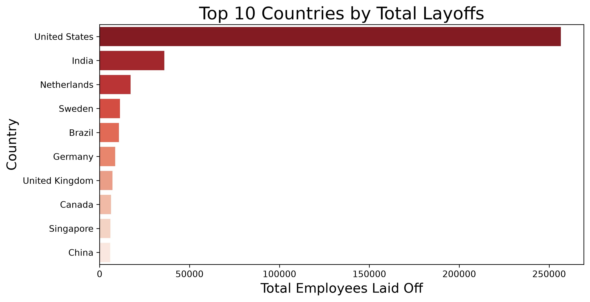

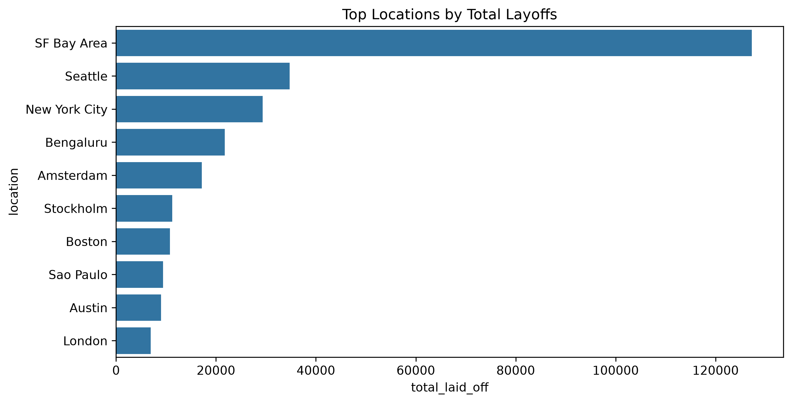

### 🏭 2. Industries

- **Consumer** (about 46,000) and **Retail** (about 43,000) saw the most layoffs, followed by Other, Transportation, Finance and Healthcare.
- In **2020**, Travel and Transportation led (COVID impact). In **2022 to 2023**, Consumer, Retail, Healthcare and Finance were hit hardest.

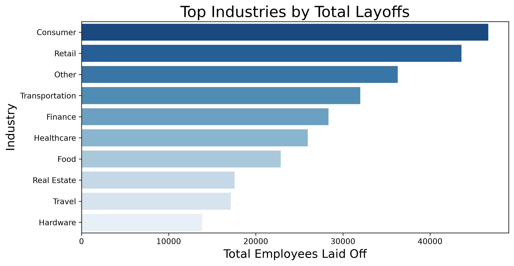

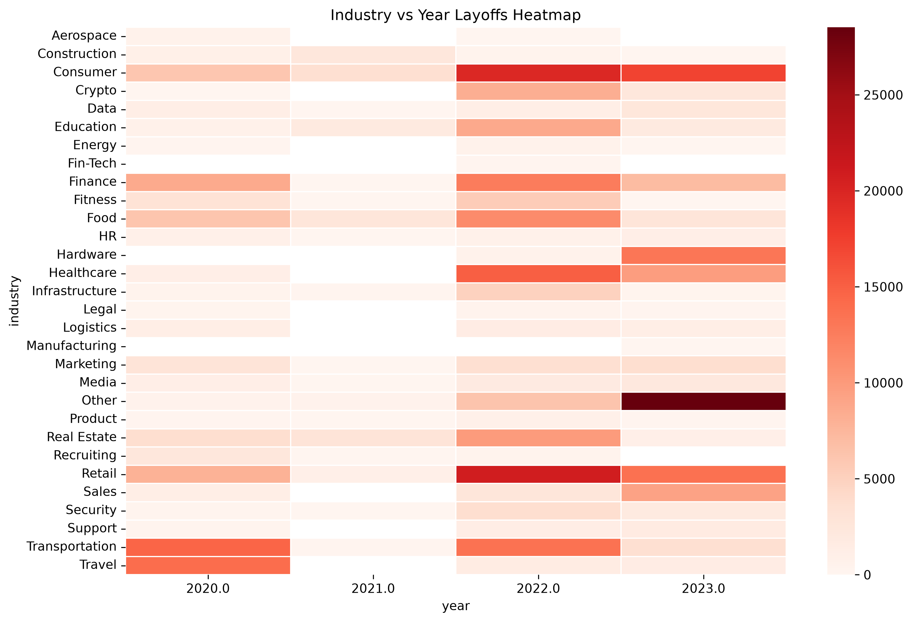

### 🏢 3. Companies

- **Amazon** (about 18,150), **Google** (about 12,000) and **Meta** (about 11,000) top the list.
- The top 10 companies together account for roughly a quarter (about 26%) of all layoffs.

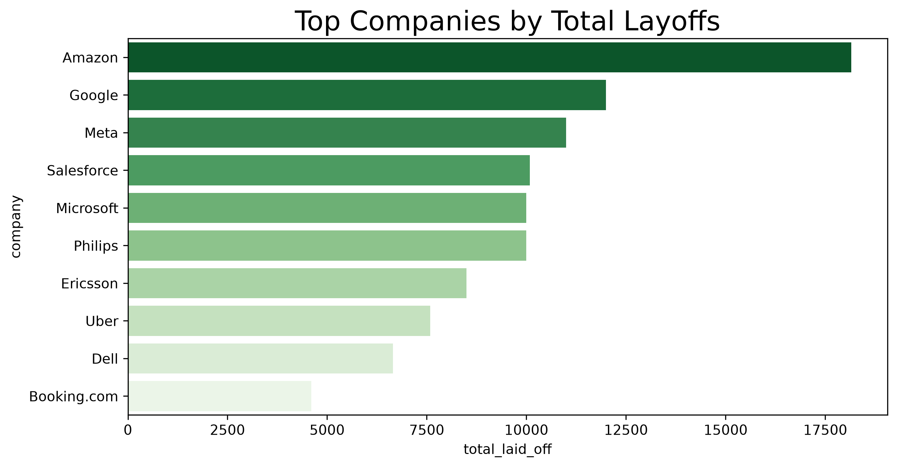

### 📅 4. Time Trends

- Layoffs: about **81.1k (2020)**, **15.8k (2021)**, **161.7k (2022)**, **127.3k (2023)**. The 2023 figure covers only about two months (January to early March).
- Total layoffs peak in **January** (about 92k) and **November** (about 56k) and are lowest in **September** (about 7k). December is also low (about 12.5k).
- The median layoff event is largest in **January** (about 104 employees) and smallest in **April** (about 53).

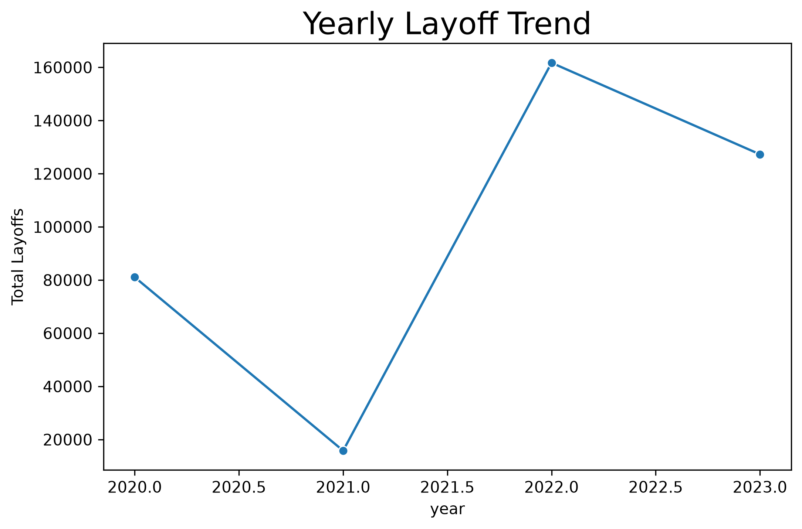

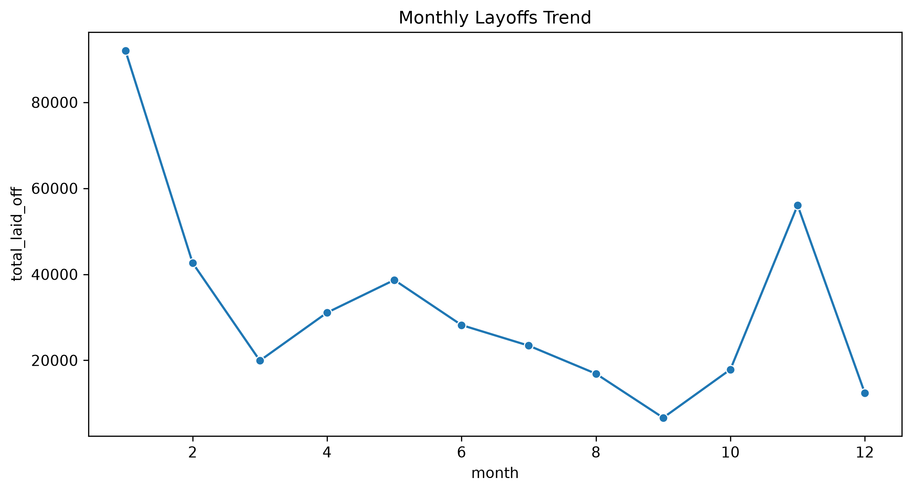

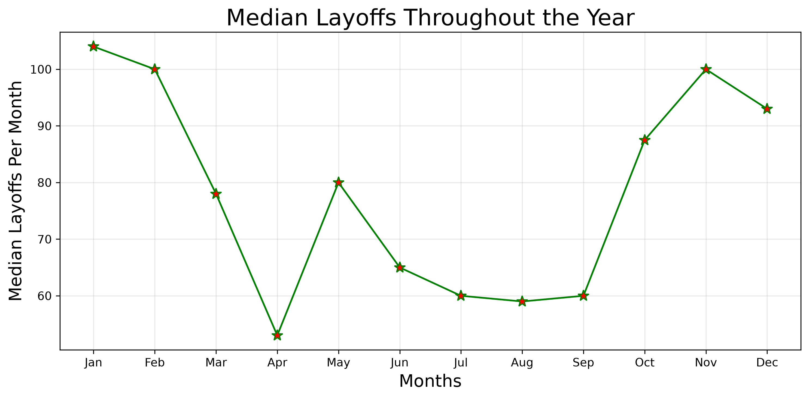

### 💰 5. Funding Stage

- **Post-IPO** companies account for about **205,000** layoffs, about 7x the next group (Acquired, about 29,000).
- Well-funded companies such as Meta, Uber, Tesla and WeWork (each with $20B or more raised) still had layoffs.

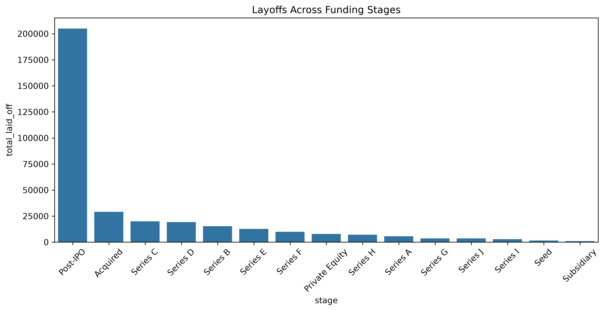

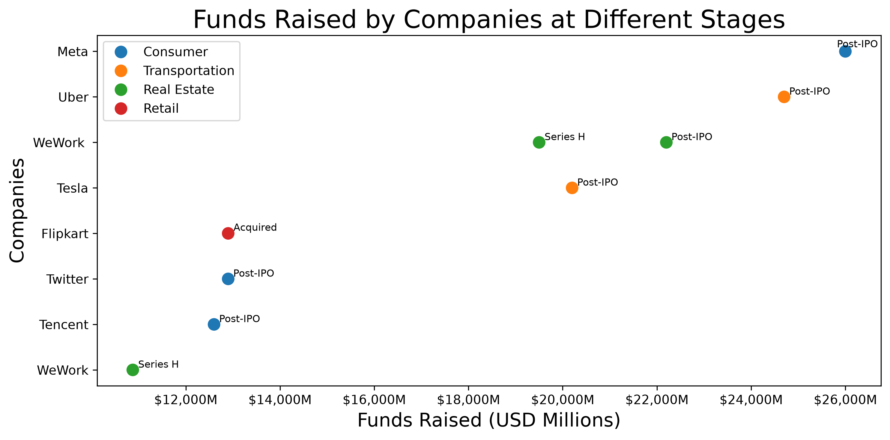

### 📊 6. Severity of Layoffs

- Most layoff events cut roughly **5 to 30%** of the workforce, with the most common level around **10 to 13%**.
- About **117 companies laid off 100%** of their workforce.
- Median severity is similar across industries (14 to 20%), but **Food** has the widest spread and **Healthcare** the highest median.

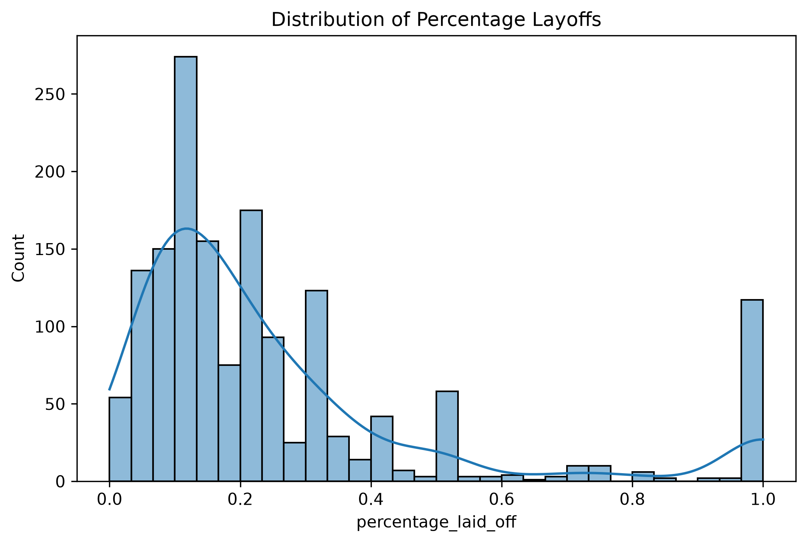

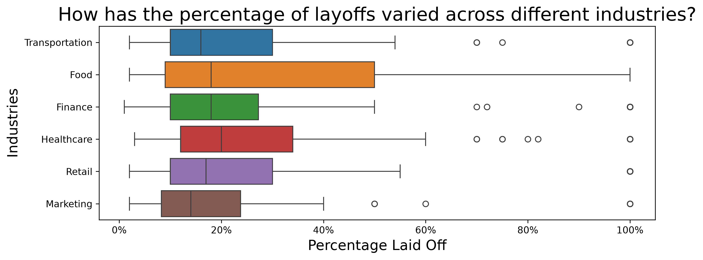

### 🔗 7. Correlation

| Pair | Correlation |
|---|---|
| Total laid off vs % laid off | -0.058 |
| Total laid off vs funds raised | 0.077 |
| % laid off vs funds raised | -0.068 |

All correlations are close to zero. **Funding raised does not predict how many people, or what share of staff, a company laid off.**

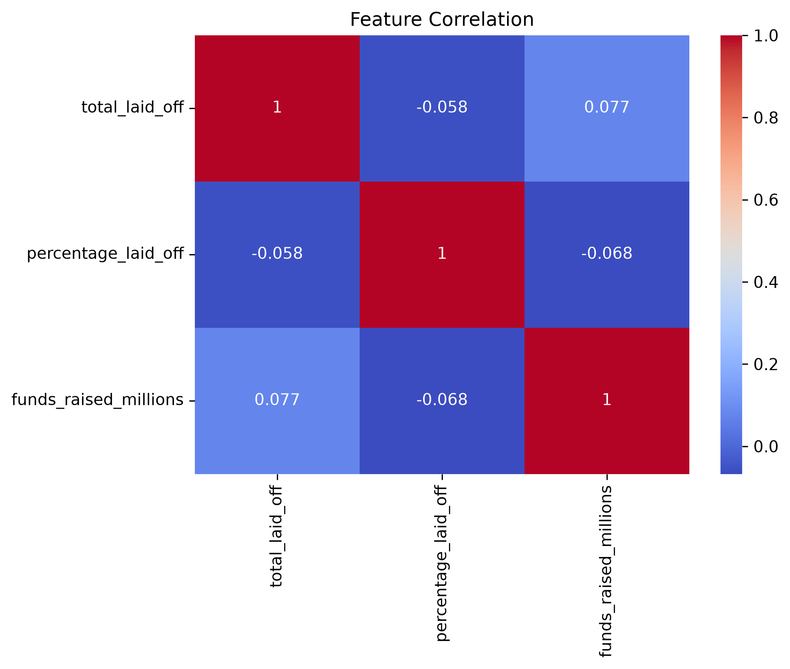

---

## ✅ Conclusion

Layoffs from 2020 to 2023 were widespread but concentrated: in the **US** (especially the **SF Bay Area**), in **consumer and retail** industries, and among **large, post-IPO companies**. Activity peaked in **2022**, and monthly totals were largest in **January** and **November**. Funding showed almost no relationship with layoff size, so funding alone does not explain which companies cut jobs.

---

## ⚠️ Limitations

- `total_laid_off` totals only include rows where the value is available; rows with missing values are ignored.
- **2023 only covers January to early March** (the data runs from March 2020 to March 2023), so it should not be compared directly with full years.
- Monthly charts **pool all years together**, so spikes (e.g., January) may be driven by a few large events in a single year.
- The **"Other"** industry category is large and not broken down further.
- Findings show correlation and patterns, not causation.

---

## 🛠️ Tech Stack

- **Python 3**
- **pandas**, **NumPy** for data manipulation
- **Matplotlib**, **Seaborn** for visualization
- **adjustText** for label placement
- **Jupyter Notebook**

---

## 🚀 How to Run

1. **Clone the repository**

   ```bash
   git clone https://github.com/umeedansari/Layoffs-Data-Analysis.git
   cd Layoffs-Data-Analysis
   ```

2. **Install dependencies**

   ```bash
   pip install -r requirements.txt
   ```

3. **Open the notebook**

   ```bash
   jupyter notebook notebooks/layoffs_eda.ipynb
   ```

4. Make sure `data/raw/raw_layoff.csv` exists, then run all cells. Update the file paths in the notebook if needed.

---

## 🔮 Future Work

- Build an interactive dashboard (Power BI, Tableau or Plotly Dash)
- Break down the "Other" industry category
- Add predictive modeling for layoff risk
- Compare layoffs against macroeconomic indicators (interest rates, inflation, stock indices)

---

## 📄 License

This project is licensed under the terms of the [LICENSE](LICENSE) file.

---

## 👤 Author

**Umeed Ansari**

[GitHub](https://github.com/umeedansari) · [LinkedIn](https://linkedin.com/in/umeedansari)

⭐ If you found this project useful, consider giving it a star!